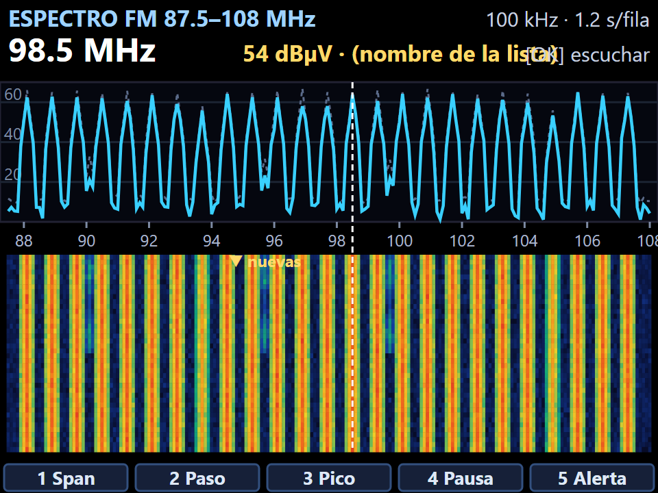

# Waterfall en el DP-666: análisis antes de programar

Revisión del 2026-10-16 para el fork de XE1E de [PE5PVB/TEF6686_ESP32](https://github.com/PE5PVB/TEF6686_ESP32),
pensando en el **Deepelec DP-666**. Objetivo: decidir si un waterfall es útil de verdad en
este radio, cómo debe funcionar y qué límites pone el hardware, **antes** de escribir código.

> **Actualización (2026-10-16, tras revisar los proyectos relacionados):** el modo *AF update*
> existe **sólo en FM**; en AM (LW/MW/SW) cualquier barrido corta el audio, y cada punto necesita
> **~40 ms** para medir bien (medido por zeevy en el ATS-125). En FM, con modo *Search* + 4 ms, la
> banda completa baja a **~1.1 s**. Detalle en [PROYECTOS-RELACIONADOS.md](PROYECTOS-RELACIONADOS.md),
> sección 11.

## 1. Resumen

- **Se puede hacer, pero no es el waterfall de un SDR.** El TEF6686 sintoniza una sola
  frecuencia a la vez y no entrega muestras I/Q: el espectro se arma **barriendo**
  (sintonizar, medir el nivel, siguiente). Cada barrido es un renglón del waterfall.
- **Dos formas de barrer:**
  1. **Modo Espectro** (pantalla aparte, sin audio): rápido, del orden de **1 s por renglón
     en toda la FM** y fracciones de segundo en tramos cortos.
  2. **Monitor de fondo** (mientras escuchas): con el modo *AF update* del chip, que mide
     otra frecuencia y **regresa solo** a la que suena, como hacen los autoestéreos con RDS.
     Lento (decenas de segundos por renglón) y hay que comprobar en el radio qué tanto se oye.
- **Utilidad real:** en la FM de la CDMX la vista de banda completa sale casi fija (rayas de
  emisoras locales, ver la maqueta). Lo valioso no es «ver la banda», sino **ver lo que
  cambia**: aperturas de propagación (Es, tropo), emisoras lejanas que aparecen y se van,
  la onda media al anochecer y la ocupación de las bandas de onda corta. El diseño debe
  girar alrededor de eso: modo **«cambios»** y **alertas**, además del espectro normal.
- **Primero medir en el radio.** Hay tres números que deciden el diseño y no se pueden
  sacar del papel (sección 6). La fase 0 es un firmware de prueba que los mide.

*Maqueta a escala de la pantalla de 320×240 con datos simulados: emisoras locales de la
CDMX y tres señales «nuevas» que aparecen a media pantalla. Se ve el problema: las
locales dominan y lo interesante casi no se distingue.*

## 2. El hardware del DP-666 (diagrama V2.5.4 y manual)

| Parte | Qué es | Qué implica |
|---|---|---|
| Sintonizador | **NXP TEF6686** (Lithio), cristal de 12 MHz, I2C a 400 kHz | Una frecuencia a la vez; nivel en dBµV con 0.1 dB, ruido (USN), multitrayecto (WAM), desvío de frecuencia |
| Audio | Salida **analógica** del TEF (DAC_L/R) → MAX97220 (audífonos) y TPA6211A1 (bocina 45 mm) | El bus I2S del TEF **no llega al ESP32** (sólo puntos de prueba): el ESP32 **no recibe audio** |
| Procesador | **ESP32-WROOM-32U**, 4 MB de flash, **sin PSRAM** (~300 KB de RAM libres) | No cabe un búfer de pantalla completo con holgura; el waterfall se dibuja por renglones |
| Pantalla | IPS 2.8" **320×240**, SPI; táctil **resistivo** (XPT2046) | Resolución limitada (la FM entera son ~206 puntos: 1.5 px cada uno); tocar sí, gestos de dos dedos no |
| Controles | Perilla EC11 con botón, teclas BW / MODE / STB, **teclado numérico de 12 teclas** (expansor XL9555 por I2C) | Buenos atajos: números para span/paso, perilla para mover el cursor |
| Otros | Reloj RS4C8010 (compatible RX8010SJ), batería 5000 mAh (~15 h, 350 mA), USB-C con CH340N, WiFi y Bluetooth | Hay WiFi: el waterfall también se puede mandar a la PC o al celular |
| Bandas | FM 65-108 MHz, OC 1.7-27 MHz (paso 5 kHz), OM 520-1720 (10 kHz) y OL | Antena externa única con conector SMA |
| Firmware | El oficial es este mismo código compilado con `DEEPELEC_DP_66X` | Lo que hagamos aquí corre en el DP-666 sin adaptar la placa |
| Flash | Partición de la app de 3.7 MB; el firmware ocupa 3.3 MB | Quedan ~570 KB: de sobra para el waterfall, pero no para más fuentes grandes |

## 3. Cómo se mide: tiempos

Cada punto del barrido es: mandar «sintoniza» por I2C (~0.2 ms), esperar a que el chip
mida (**el número a averiguar**) y leer 14 bytes de calidad (~0.4 ms).

- El barrido que ya existe (lo usan XDR-GTK y FM-DX Webserver por USB/WiFi) espera **5 ms
  en FM y 8 ms en AM** por punto: unos **1.2 s para la FM completa** (206 puntos a 100 kHz).
- El modo *AF update* (`Cmd_Tune_To` modo 3) avisa cuándo ya midió: el firmware ya lo
  usa para escoger la mejor frecuencia alternativa de RDS, y en ese caso **no silencia el
  audio**. Si el chip mide en ~2-3 ms, un barrido dedicado podría bajar a ~0.6 s.

| Qué se barre | Puntos | Renglón (5 ms/pt) | Renglón (si fueran 2.5 ms/pt) |
|---|---|---|---|
| FM completa, 100 kHz | 206 | ~1.2 s | ~0.6 s |
| FM ±1 MHz, 50 kHz | 41 | ~0.25 s | ~0.12 s |
| OM 520-1720, 10 kHz | 121 | ~5 s (**40 ms en AM**, medido) | — |
| 49 m (5.9-6.2 MHz), 5 kHz | 61 | ~2.5 s (40 ms) | — |

El dibujo no es el cuello de botella: un renglón de 320 px son 640 bytes por SPI
(décimas de milisegundo). Redibujar todo el waterfall (~320×100) son ~13 ms.

**Ojo con el filtro de FI:** en FM el filtro más angosto del TEF es de 56 kHz, así que en
pasos de 50 kHz cada emisora «se embarra» en 2-3 puntos y una fuerte tapa a sus vecinas.
Es un analizador de ocupación por canal, no de espectro fino. En AM el filtro de 3 kHz sí
separa bien.

## 4. ¿Sirve de verdad? Por banda

| Uso | ¿Útil? | Por qué |
|---|---|---|
| **FM, vista completa, en la CDMX** | Poco, tal cual | Las locales son fijas: rayas verticales. Sirve una vez para ver la banda, no para estar mirándola |
| **FM, modo «cambios»** (se resta el promedio de las últimas horas) | **Mucho** | Las locales desaparecen y sólo quedan las señales que llegan o se van: aperturas de esporádica E en verano, tropo al amanecer |
| **FM, tramo de ±1 MHz** | Sí | Ver una emisora débil junto a una fuerte, qué tanto se desvanece, y elegirla con la perilla |
| **OM al anochecer** | **Mucho** | Las estaciones lejanas por onda de cielo aparecen al ponerse el sol: el waterfall de una hora lo enseña muy bien |
| **OC, bandas de radiodifusión (49, 41, 31 m)** | **Mucho** | Ocupación que cambia por hora: encontrar rápido qué está al aire |
| Señales breves (banda aérea, aficionados en voz) | No | Un barrido de 1 s se las salta; para eso sirve más un escáner con «retener en señal», que el firmware ya tiene |
| Ver modulación o forma de una señal | No | No hay I/Q ni audio en el ESP32 |

**Conclusión:** el valor está en tres cosas: **(1) modo cambios en FM, (2) OM y OC en
periodos largos, (3) alertas de apertura**. El espectro «bonito» de banda completa es lo
de menos.

## 5. Diseño propuesto

**Pantalla Espectro** (maqueta arriba):

- **Arriba:** banda y span, paso y segundos por renglón; frecuencia del cursor, nivel y
  nombre (de la lista de estaciones o del RDS si ya se conoce).
- **Espectro:** el barrido actual (línea) y el **máximo** visto (punteada).
- **Waterfall:** cada renglón un barrido; colores de azul (nada) a rojo (fuerte), con
  el umbral y la escala ajustables.
- **Teclas:** 1 Span (banda completa / ±1 MHz / ±250 kHz), 2 Paso, 3 Pico (máximo,
  reiniciar), 4 Pausa, 5 Alerta, 6 **Cambios** (resta la referencia), 0 Guardar captura.
  La **perilla** mueve el cursor; su **botón** sintoniza la frecuencia y sale a escuchar.
  **Tocar** una columna también la elige.
- **Identificar:** sobre una señal, una tecla escucha ~1 s para leer el RDS (PI, PS) y
  regresa; el nombre queda en la pantalla y en el registro.

**Monitor de fondo** (mientras escuchas): mide un punto cada ~100-200 ms con *AF update*.
La FM completa toma ~20-40 s por renglón: un waterfall lento en una franja de la pantalla
normal, o sólo las alertas. Sólo si la prueba de la sección 6 dice que no se oye.

**Alertas:** cuando aparece una señal sobre el umbral en un canal que en la referencia
estaba vacío, el radio avisa (pitido o icono), la anota en el registro (`logbook.cpp` ya
existe) y, con WiFi, puede **mandar el aviso** (por ejemplo, al Telegram de la estación).

**WiFi:** el mismo barrido se puede ver en grande en la PC o el celular. FM-DX Webserver
ya lo dibuja; una página propia del radio sería una fase posterior.

## 6. Lo que hay que medir primero (fase 0)

Un firmware de prueba que **no cambia nada del uso normal** y sólo agrega una pantalla de
pruebas. Mide:

1. **Tiempo real por punto** con modo *Jump* + espera y con *AF update* (FM y AM), y si el
   nivel medido es igual de confiable con esperas más cortas (comparar contra 20 ms).
2. **¿Se oye el monitor de fondo?** Escuchar una emisora mientras se miden 1, 5, 10 y 20
   puntos por segundo con *AF update*. Si se oyen golpes, el monitor de fondo se descarta
   o se limita a alertas muy espaciadas.
3. **Efecto en el RDS:** si el monitor de fondo hace perder sincronía del RDS.

Con esos tres datos se fija el diseño final.

## 7. Plan por fases

| Fase | Qué | Necesita el radio |
|---|---|---|
| 0 | Firmware de prueba: tiempos, audibilidad, RDS | Sí |
| 1 | Pantalla Espectro básica: barrido, espectro, waterfall, cursor, escuchar al salir | Sí, para probar |
| 2 | Modo cambios, máximo, spans y pasos, identificar por RDS | Sí |
| 3 | Alertas, registro y aviso por WiFi | Sí |
| 4 | Monitor de fondo (si la fase 0 lo permite) | Sí |
| 5 | Vista por WiFi en la PC o el celular | Sí |

Todo detrás de la opción de compilación del DP-666 donde dependa del teclado, para no
romper los demás radios y poder proponerlo a PE5PVB como pull request.

## 8. Otras propuestas de funciones y mejoras

Por orden de lo que creo que más te serviría:

1. **Revisión del español (México)**: el firmware ya trae español; revisarlo como hicimos
   con WPSD.
2. **Lista de estaciones de México**: en México casi no hay RDS, así que el nombre no
   llega solo. Una lista por frecuencia para la CDMX (y la que elijas) con datos públicos
   del IFT, mostrada al sintonizar y en el cursor del espectro.
3. **Registro de nivel de una estación en el tiempo** (gráfica de horas): para estudiar
   propagación de una emisora lejana. Se puede descargar por WiFi.
4. **Alertas de propagación** aunque no estés en la pantalla Espectro (ligado al monitor).
5. **Indicador de batería en porcentaje calibrado** para la celda de 5000 mAh del DP-666.
6. **Atajos del teclado numérico**: memorias por número, banda directa, etc. (revisar qué
   hace ya el firmware oficial con el teclado).
7. **Escáner de OM/OC por hora**: barrer una banda cada X minutos toda la noche y guardar
   un mapa de ocupación, para ver qué se escucha a qué hora.

## 9. Límites del hardware (lo que NO se puede)

- **Waterfall en tiempo real tipo SDR**: no hay I/Q; sólo barrido.
- **Escuchar y barrer rápido a la vez**: el barrido rápido es sin audio.
- **Decodificar audio** (CW, SSB, modos digitales, grabar): el audio no llega al ESP32.
  SSB/CW con el TEF tampoco: es un sintonizador de radiodifusión (AM/FM).
- **Resolución fina en FM**: filtro mínimo de 56 kHz.
- **HD Radio / DAB**: el TEF6686 no los decodifica.
- **Gestos multitáctiles**: el táctil es resistivo.
- **Búfer de pantalla completo**: sin PSRAM; se dibuja por renglones (no limita al waterfall).

## 10. Notas

- Licencia **GPL-3.0**: el fork y lo que se distribuya deben seguir abiertos.
- Agregar opciones cambia el mapa de la EEPROM: hay que usar direcciones libres para no
  chocar con las actualizaciones de PE5PVB.
- El fork se mantiene al día con `git fetch upstream` + merge de `upstream/main`.
